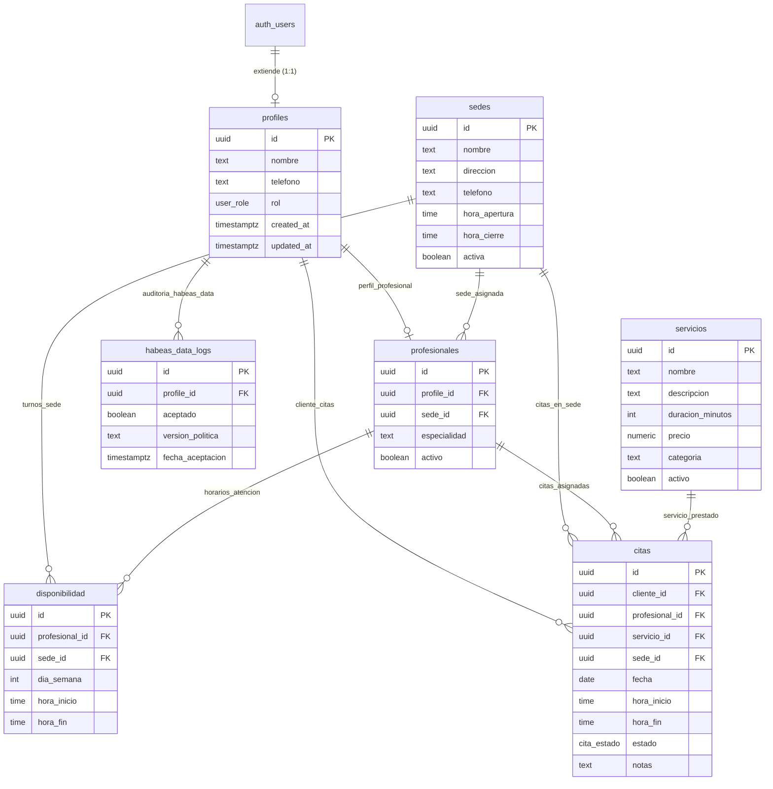

# DATABASE_SCHEMA.md
## Esquema Relacional y Seguridad PostgreSQL para Supabase (Punto Corte)

Este documento contiene la definición completa del esquema de base de datos, relaciones, políticas de seguridad a nivel de fila (Row Level Security - RLS), funciones auxiliares, triggers anti-traslape y datos semilla (seed) para desplegar en el SQL Editor de Supabase.

---

### 1. Diagrama Entidad-Relación (Mermaid)



---

### 2. Script SQL Completo para Supabase (Copiar y Ejecutar en SQL Editor)

```sql
-- ============================================================================
-- PROYECTO: GESTIÓN DE CITAS PUNTO CORTE (BUCARAMANGA - CAÑAVERAL)
-- AUTOR: Arquitecto de Software Full-Stack
-- DESCRIPCIÓN: Estructura de BD, Triggers, RLS y Funciones Anti-Traslape
-- ============================================================================

-- 1. EXTENSIONES
CREATE EXTENSION IF NOT EXISTS "uuid-ossp";
CREATE EXTENSION IF NOT EXISTS "pgcrypto";

-- 2. TIPOS ENUMERADOS (ENUMS)
DO $$ BEGIN
    IF NOT EXISTS (SELECT 1 FROM pg_type WHERE typname = 'user_role') THEN
        CREATE TYPE user_role AS ENUM ('cliente', 'profesional', 'cajera', 'admin');
    END IF;
    IF NOT EXISTS (SELECT 1 FROM pg_type WHERE typname = 'cita_estado') THEN
        CREATE TYPE cita_estado AS ENUM ('pendiente', 'confirmada', 'atendida', 'cancelada');
    END IF;
END $$;

-- 3. TABLA: profiles (Extensión del usuario en auth.users)
CREATE TABLE IF NOT EXISTS public.profiles (
    id UUID PRIMARY KEY REFERENCES auth.users(id) ON DELETE CASCADE,
    nombre TEXT NOT NULL,
    telefono TEXT,
    rol user_role NOT NULL DEFAULT 'cliente',
    created_at TIMESTAMPTZ NOT NULL DEFAULT timezone('utc'::text, now()),
    updated_at TIMESTAMPTZ NOT NULL DEFAULT timezone('utc'::text, now())
);

-- 4. TABLA: sedes (Sede Principal y Sede 2 en Cañaveral)
CREATE TABLE IF NOT EXISTS public.sedes (
    id UUID PRIMARY KEY DEFAULT gen_random_uuid(),
    nombre TEXT NOT NULL,
    direccion TEXT NOT NULL,
    telefono TEXT,
    hora_apertura TIME NOT NULL DEFAULT '09:00:00',
    hora_cierre TIME NOT NULL DEFAULT '20:00:00',
    activa BOOLEAN NOT NULL DEFAULT true,
    created_at TIMESTAMPTZ NOT NULL DEFAULT timezone('utc'::text, now())
);

-- 5. TABLA: profesionales
CREATE TABLE IF NOT EXISTS public.profesionales (
    id UUID PRIMARY KEY DEFAULT gen_random_uuid(),
    profile_id UUID NOT NULL REFERENCES public.profiles(id) ON DELETE CASCADE,
    sede_id UUID NOT NULL REFERENCES public.sedes(id) ON DELETE RESTRICT,
    especialidad TEXT NOT NULL, -- ej: 'Barbería', 'Uñas', 'Barbería y Estilo'
    activo BOOLEAN NOT NULL DEFAULT true,
    created_at TIMESTAMPTZ NOT NULL DEFAULT timezone('utc'::text, now()),
    CONSTRAINT uq_profesional_profile UNIQUE(profile_id)
);

-- 6. TABLA: servicios (Catálogo de cortes, barbas, manicura, etc.)
CREATE TABLE IF NOT EXISTS public.servicios (
    id UUID PRIMARY KEY DEFAULT gen_random_uuid(),
    nombre TEXT NOT NULL,
    descripcion TEXT,
    duracion_minutos INTEGER NOT NULL CHECK (duracion_minutos > 0 AND duracion_minutos <= 300),
    precio NUMERIC(12,2) NOT NULL CHECK (precio >= 0),
    categoria TEXT NOT NULL, -- 'Barbería', 'Uñas', 'Tratamientos'
    activo BOOLEAN NOT NULL DEFAULT true,
    created_at TIMESTAMPTZ NOT NULL DEFAULT timezone('utc'::text, now())
);

-- 7. TABLA: disponibilidad (Horarios semanales de trabajo por profesional)
-- dia_semana: 0 = Domingo, 1 = Lunes, ..., 6 = Sábado
CREATE TABLE IF NOT EXISTS public.disponibilidad (
    id UUID PRIMARY KEY DEFAULT gen_random_uuid(),
    profesional_id UUID NOT NULL REFERENCES public.profesionales(id) ON DELETE CASCADE,
    sede_id UUID NOT NULL REFERENCES public.sedes(id) ON DELETE CASCADE,
    dia_semana INTEGER NOT NULL CHECK (dia_semana >= 0 AND dia_semana <= 6),
    hora_inicio TIME NOT NULL,
    hora_fin TIME NOT NULL,
    created_at TIMESTAMPTZ NOT NULL DEFAULT timezone('utc'::text, now()),
    CONSTRAINT ck_rango_horario CHECK (hora_fin > hora_inicio)
);

-- 8. TABLA: citas
CREATE TABLE IF NOT EXISTS public.citas (
    id UUID PRIMARY KEY DEFAULT gen_random_uuid(),
    cliente_id UUID NOT NULL REFERENCES public.profiles(id) ON DELETE RESTRICT,
    profesional_id UUID NOT NULL REFERENCES public.profesionales(id) ON DELETE RESTRICT,
    servicio_id UUID NOT NULL REFERENCES public.servicios(id) ON DELETE RESTRICT,
    sede_id UUID NOT NULL REFERENCES public.sedes(id) ON DELETE RESTRICT,
    fecha DATE NOT NULL,
    hora_inicio TIME NOT NULL,
    hora_fin TIME NOT NULL,
    estado cita_estado NOT NULL DEFAULT 'confirmada',
    notas TEXT,
    created_at TIMESTAMPTZ NOT NULL DEFAULT timezone('utc'::text, now()),
    updated_at TIMESTAMPTZ NOT NULL DEFAULT timezone('utc'::text, now()),
    CONSTRAINT ck_citas_rango_horario CHECK (hora_fin > hora_inicio),
    CONSTRAINT ck_citas_rango_atencion CHECK (hora_inicio >= '09:00:00' AND hora_fin <= '20:00:00')
);

-- 9. TABLA: habeas_data_logs (Cumplimiento Ley 1581 de 2012)
CREATE TABLE IF NOT EXISTS public.habeas_data_logs (
    id UUID PRIMARY KEY DEFAULT gen_random_uuid(),
    profile_id UUID NOT NULL REFERENCES public.profiles(id) ON DELETE CASCADE,
    aceptado BOOLEAN NOT NULL DEFAULT true,
    version_politica TEXT NOT NULL DEFAULT 'v1.0-2025',
    fecha_aceptacion TIMESTAMPTZ NOT NULL DEFAULT timezone('utc'::text, now())
);

-- ============================================================================
-- 10. ÍNDICES DE RENDIMIENTO (OPTIMIZACIÓN DE CONSULTAS)
-- ============================================================================
CREATE INDEX IF NOT EXISTS idx_citas_prof_fecha ON public.citas(profesional_id, fecha, hora_inicio, hora_fin);
CREATE INDEX IF NOT EXISTS idx_citas_cliente_fecha ON public.citas(cliente_id, fecha);
CREATE INDEX IF NOT EXISTS idx_citas_sede_fecha ON public.citas(sede_id, fecha);
CREATE INDEX IF NOT EXISTS idx_disponibilidad_prof ON public.disponibilidad(profesional_id, dia_semana);

-- ============================================================================
-- 11. FUNCIONES AUXILIARES & SINCRONIZACIÓN AUTOMÁTICA DE PERFILES
-- ============================================================================

-- Función segura para obtener el rol del usuario autenticado (evita recursión en RLS)
CREATE OR REPLACE FUNCTION public.get_user_role()
RETURNS user_role AS $$
    SELECT rol FROM public.profiles WHERE id = auth.uid();
$$ LANGUAGE sql STABLE SECURITY DEFINER;

-- Trigger para crear perfil automáticamente cuando un usuario se registra en auth.users
CREATE OR REPLACE FUNCTION public.handle_new_user()
RETURNS TRIGGER AS $$
DECLARE
    v_rol user_role := 'cliente';
    v_nombre text;
    v_telefono text;
BEGIN
    v_nombre := COALESCE(new.raw_user_meta_data->>'nombre', new.raw_user_meta_data->>'full_name', split_part(new.email, '@', 1));
    v_telefono := new.raw_user_meta_data->>'telefono';

    -- Si se especifica rol en la metadata y es válido (ej. creado por admin)
    IF new.raw_user_meta_data->>'rol' IS NOT NULL THEN
        v_rol := (new.raw_user_meta_data->>'rol')::user_role;
    END IF;

    INSERT INTO public.profiles (id, nombre, telefono, rol)
    VALUES (new.id, v_nombre, v_telefono, v_rol)
    ON CONFLICT (id) DO NOTHING;

    -- Registro de auditoría Habeas Data si fue marcado en el registro
    IF (new.raw_user_meta_data->>'habeas_data_aceptado')::boolean IS TRUE THEN
        INSERT INTO public.habeas_data_logs (profile_id, aceptado, version_politica)
        VALUES (new.id, true, COALESCE(new.raw_user_meta_data->>'habeas_data_version', 'v1.0-2025'));
    END IF;

    RETURN new;
END;
$$ LANGUAGE plpgsql SECURITY DEFINER;

DROP TRIGGER IF EXISTS on_auth_user_created ON auth.users;
CREATE TRIGGER on_auth_user_created
    AFTER INSERT ON auth.users
    FOR EACH ROW EXECUTE FUNCTION public.handle_new_user();

-- ============================================================================
-- 12. LÓGICA CORE ANTI-TRASLAPE (INTEGRIDAD DE AGENDAMIENTO)
-- ============================================================================

-- Función que valida que una cita no traslape con otra existente para el mismo profesional
CREATE OR REPLACE FUNCTION public.fn_check_cita_overlap()
RETURNS TRIGGER AS $$
DECLARE
    v_overlap_count INTEGER;
BEGIN
    -- Solo verificar citas que no estén canceladas
    IF NEW.estado = 'cancelada' THEN
        RETURN NEW;
    END IF;

    SELECT COUNT(*)
    INTO v_overlap_count
    FROM public.citas
    WHERE profesional_id = NEW.profesional_id
      AND fecha = NEW.fecha
      AND estado != 'cancelada'
      AND id != COALESCE(NEW.id, '00000000-0000-0000-0000-000000000000'::uuid)
      -- Condición de cruce de intervalos: [hora_inicio, hora_fin)
      AND (
          (NEW.hora_inicio >= hora_inicio AND NEW.hora_inicio < hora_fin) OR
          (NEW.hora_fin > hora_inicio AND NEW.hora_fin <= hora_fin) OR
          (NEW.hora_inicio <= hora_inicio AND NEW.hora_fin >= hora_fin)
      );

    IF v_overlap_count > 0 THEN
        RAISE EXCEPTION 'El profesional ya tiene una cita agendada en este horario (% a %).', NEW.hora_inicio, NEW.hora_fin
        USING ERRCODE = '23P01'; -- Exclusión de integridad de negocio
    END IF;

    RETURN NEW;
END;
$$ LANGUAGE plpgsql;

DROP TRIGGER IF EXISTS tr_check_cita_overlap ON public.citas;
CREATE TRIGGER tr_check_cita_overlap
    BEFORE INSERT OR UPDATE OF profesional_id, fecha, hora_inicio, hora_fin, estado
    ON public.citas
    FOR EACH ROW
    EXECUTE FUNCTION public.fn_check_cita_overlap();

-- Función RPC para agendar cita con verificación atómica y cálculo automático de hora_fin
CREATE OR REPLACE FUNCTION public.crear_cita(
    p_cliente_id UUID,
    p_profesional_id UUID,
    p_servicio_id UUID,
    p_sede_id UUID,
    p_fecha DATE,
    p_hora_inicio TIME,
    p_notas TEXT DEFAULT NULL
)
RETURNS JSONB AS $$
DECLARE
    v_duracion INTEGER;
    v_hora_fin TIME;
    v_new_cita RECORD;
    v_solapamiento INTEGER;
BEGIN
    -- Obtener duración del servicio
    SELECT duracion_minutos INTO v_duracion
    FROM public.servicios
    WHERE id = p_servicio_id AND activo = true;

    IF NOT FOUND THEN
        RAISE EXCEPTION 'El servicio especificado no existe o no se encuentra activo.';
    END IF;

    v_hora_fin := p_hora_inicio + (v_duracion || ' minutes')::interval;

    -- Validar que no se pase del horario de cierre (20:00)
    IF v_hora_fin > '20:00:00'::TIME THEN
        RAISE EXCEPTION 'La cita excede el horario de cierre de la sede (8:00 p.m.).';
    END IF;

    -- Insertar cita (el trigger verificará traslapes)
    INSERT INTO public.citas (
        cliente_id,
        profesional_id,
        servicio_id,
        sede_id,
        fecha,
        hora_inicio,
        hora_fin,
        estado,
        notas
    )
    VALUES (
        p_cliente_id,
        p_profesional_id,
        p_servicio_id,
        p_sede_id,
        p_fecha,
        p_hora_inicio,
        v_hora_fin,
        'confirmada',
        p_notas
    )
    RETURNING * INTO v_new_cita;

    RETURN jsonb_build_object(
        'success', true,
        'cita_id', v_new_cita.id,
        'fecha', v_new_cita.fecha,
        'hora_inicio', v_new_cita.hora_inicio,
        'hora_fin', v_new_cita.hora_fin,
        'estado', v_new_cita.estado
    );
END;
$$ LANGUAGE plpgsql SECURITY DEFINER;

-- ============================================================================
-- 13. SEGURIDAD Y POLÍTICAS ROW LEVEL SECURITY (RLS)
-- ============================================================================

-- Habilitar RLS en todas las tablas
ALTER TABLE public.profiles ENABLE ROW LEVEL SECURITY;
ALTER TABLE public.sedes ENABLE ROW LEVEL SECURITY;
ALTER TABLE public.profesionales ENABLE ROW LEVEL SECURITY;
ALTER TABLE public.servicios ENABLE ROW LEVEL SECURITY;
ALTER TABLE public.disponibilidad ENABLE ROW LEVEL SECURITY;
ALTER TABLE public.citas ENABLE ROW LEVEL SECURITY;
ALTER TABLE public.habeas_data_logs ENABLE ROW LEVEL SECURITY;

-- 13.1 Políticas para PROFILES
DROP POLICY IF EXISTS "Lectura de perfiles para usuarios autenticados" ON public.profiles;
CREATE POLICY "Lectura de perfiles para usuarios autenticados"
    ON public.profiles FOR SELECT
    TO authenticated
    USING (true);

DROP POLICY IF EXISTS "Usuarios pueden actualizar su propio perfil" ON public.profiles;
CREATE POLICY "Usuarios pueden actualizar su propio perfil"
    ON public.profiles FOR UPDATE
    TO authenticated
    USING (auth.uid() = id)
    WITH CHECK (auth.uid() = id);

-- 13.2 Políticas para SEDES (Catálogo público de lectura)
DROP POLICY IF EXISTS "Lectura pública de sedes" ON public.sedes;
CREATE POLICY "Lectura pública de sedes"
    ON public.sedes FOR SELECT
    TO anon, authenticated
    USING (activa = true);

DROP POLICY IF EXISTS "Solo administradores gestionan sedes" ON public.sedes;
CREATE POLICY "Solo administradores gestionan sedes"
    ON public.sedes FOR ALL
    TO authenticated
    USING (public.get_user_role() = 'admin')
    WITH CHECK (public.get_user_role() = 'admin');

-- 13.3 Políticas para PROFESIONALES (Lectura pública)
DROP POLICY IF EXISTS "Lectura pública de profesionales" ON public.profesionales;
CREATE POLICY "Lectura pública de profesionales"
    ON public.profesionales FOR SELECT
    TO anon, authenticated
    USING (activo = true);

DROP POLICY IF EXISTS "Solo administradores gestionan profesionales" ON public.profesionales;
CREATE POLICY "Solo administradores gestionan profesionales"
    ON public.profesionales FOR ALL
    TO authenticated
    USING (public.get_user_role() = 'admin')
    WITH CHECK (public.get_user_role() = 'admin');

-- 13.4 Políticas para SERVICIOS (Catálogo público)
DROP POLICY IF EXISTS "Lectura pública de servicios" ON public.servicios;
CREATE POLICY "Lectura pública de servicios"
    ON public.servicios FOR SELECT
    TO anon, authenticated
    USING (activo = true);

DROP POLICY IF EXISTS "Solo administradores gestionan servicios" ON public.servicios;
CREATE POLICY "Solo administradores gestionan servicios"
    ON public.servicios FOR ALL
    TO authenticated
    USING (public.get_user_role() = 'admin')
    WITH CHECK (public.get_user_role() = 'admin');

-- 13.5 Políticas para DISPONIBILIDAD
DROP POLICY IF EXISTS "Lectura de disponibilidad de profesionales" ON public.disponibilidad;
CREATE POLICY "Lectura de disponibilidad de profesionales"
    ON public.disponibilidad FOR SELECT
    TO anon, authenticated
    USING (true);

DROP POLICY IF EXISTS "Admin, cajeras y profesional asignado modifican disponibilidad" ON public.disponibilidad;
CREATE POLICY "Admin, cajeras y profesional asignado modifican disponibilidad"
    ON public.disponibilidad FOR ALL
    TO authenticated
    USING (
        public.get_user_role() IN ('admin', 'cajera') OR
        profesional_id IN (SELECT id FROM public.profesionales WHERE profile_id = auth.uid())
    )
    WITH CHECK (
        public.get_user_role() IN ('admin', 'cajera') OR
        profesional_id IN (SELECT id FROM public.profesionales WHERE profile_id = auth.uid())
    );

-- 13.6 Políticas para CITAS
-- Lectura:
-- - Cliente: ve sus propias citas.
-- - Profesional: ve las citas asignadas a él.
-- - Cajera y Admin: ven todas las citas.
DROP POLICY IF EXISTS "Lectura de citas según rol" ON public.citas;
CREATE POLICY "Lectura de citas según rol"
    ON public.citas FOR SELECT
    TO authenticated
    USING (
        cliente_id = auth.uid() OR
        profesional_id IN (SELECT id FROM public.profesionales WHERE profile_id = auth.uid()) OR
        public.get_user_role() IN ('cajera', 'admin')
    );

-- Inserción:
-- - Clientes pueden insertar citas para sí mismos.
-- - Cajeras y Admin pueden insertar citas para cualquier cliente.
DROP POLICY IF EXISTS "Creación de citas según rol" ON public.citas;
CREATE POLICY "Creación de citas según rol"
    ON public.citas FOR INSERT
    TO authenticated
    WITH CHECK (
        (cliente_id = auth.uid() AND public.get_user_role() = 'cliente') OR
        public.get_user_role() IN ('cajera', 'admin')
    );

-- Actualización:
-- - Clientes pueden actualizar únicamente para cancelar su propia cita.
-- - Profesionales pueden actualizar el estado de sus citas asignadas.
-- - Cajeras y Admin pueden actualizar cualquier campo de las citas.
DROP POLICY IF EXISTS "Actualización de citas según rol" ON public.citas;
CREATE POLICY "Actualización de citas según rol"
    ON public.citas FOR UPDATE
    TO authenticated
    USING (
        (cliente_id = auth.uid() AND public.get_user_role() = 'cliente') OR
        profesional_id IN (SELECT id FROM public.profesionales WHERE profile_id = auth.uid()) OR
        public.get_user_role() IN ('cajera', 'admin')
    )
    WITH CHECK (
        (cliente_id = auth.uid() AND public.get_user_role() = 'cliente') OR
        profesional_id IN (SELECT id FROM public.profesionales WHERE profile_id = auth.uid()) OR
        public.get_user_role() IN ('cajera', 'admin')
    );

-- 13.7 Políticas para HABEAS DATA LOGS
DROP POLICY IF EXISTS "Usuarios pueden registrar su propia aceptación" ON public.habeas_data_logs;
CREATE POLICY "Usuarios pueden registrar su propia aceptación"
    ON public.habeas_data_logs FOR INSERT
    TO authenticated
    WITH CHECK (profile_id = auth.uid());

DROP POLICY IF EXISTS "Admin puede consultar logs de Habeas Data" ON public.habeas_data_logs;
CREATE POLICY "Admin puede consultar logs de Habeas Data"
    ON public.habeas_data_logs FOR SELECT
    TO authenticated
    USING (public.get_user_role() = 'admin' OR profile_id = auth.uid());

-- ============================================================================
-- 14. DATOS SEMILLA (SEED DATA INICIAL)
-- ============================================================================

-- Inserción de las dos sedes en Cañaveral, Bucaramanga
INSERT INTO public.sedes (id, nombre, direccion, telefono, hora_apertura, hora_cierre, activa)
VALUES 
    ('11111111-1111-1111-1111-111111111111', 'Sede Principal Cañaveral', 'Calle 30 # 25-14, Cañaveral, Floridablanca', '+57 318 000 0001', '09:00:00', '20:00:00', true),
    ('22222222-2222-2222-2222-222222222222', 'Sede 2 Cañaveral (Uñas & Barbería)', 'Carrera 26 # 29-45, Cañaveral, Floridablanca', '+57 318 000 0002', '09:00:00', '20:00:00', true)
ON CONFLICT (id) DO NOTHING;

-- Inserción del catálogo de servicios inicial con UUIDs fijos para evitar duplicados en re-ejecución
INSERT INTO public.servicios (id, nombre, descripcion, duracion_minutos, precio, categoria, activo)
VALUES 
    ('33333333-3333-3333-3333-333333333001', 'Corte Clásico / Fade', 'Corte de cabello personalizado con perfilado de cuello y lavado.', 45, 25000.00, 'Barbería', true),
    ('33333333-3333-3333-3333-333333333002', 'Arreglo de Barba Tradicional', 'Diseño y afeitado de barba con toalla caliente y aceites hidratantes.', 30, 18000.00, 'Barbería', true),
    ('33333333-3333-3333-3333-333333333003', 'Combo Corte + Barba', 'Servicio completo: corte de cabello de diseño y ritual de barba con toalla caliente.', 60, 38000.00, 'Barbería', true),
    ('33333333-3333-3333-3333-333333333004', 'Corte Infantil', 'Corte amigable y paciente para niños menores de 10 años.', 30, 20000.00, 'Barbería', true),
    ('33333333-3333-3333-3333-333333333005', 'Manicura Tradicional', 'Limpieza profunda de cutículas, limado, exfoliación y esmaltado tradicional.', 45, 22000.00, 'Uñas', true),
    ('33333333-3333-3333-3333-333333333006', 'Manicura Semipermanente', 'Esmaltado de larga duración secado en lámpara UV/LED con diseño básico.', 60, 42000.00, 'Uñas', true),
    ('33333333-3333-3333-3333-333333333007', 'Pedicura Spa', 'Exfoliación con sales, remoción de asperezas, masaje relajante y esmaltado.', 50, 30000.00, 'Uñas', true),
    ('33333333-3333-3333-3333-333333333008', 'Combo Manos y Pies Semipermanente', 'Servicio completo de manicura y pedicura con esmaltado semipermanente de alta duración.', 105, 75000.00, 'Uñas', true)
ON CONFLICT (id) DO NOTHING;
```
