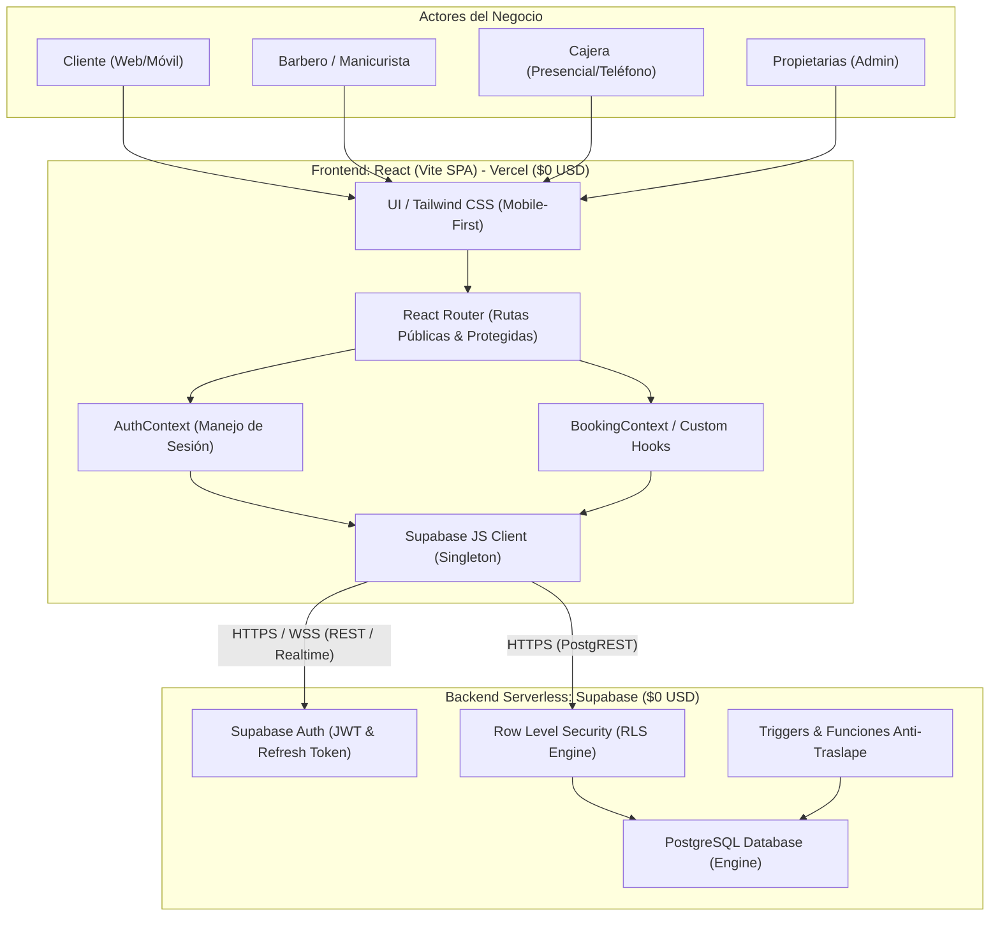
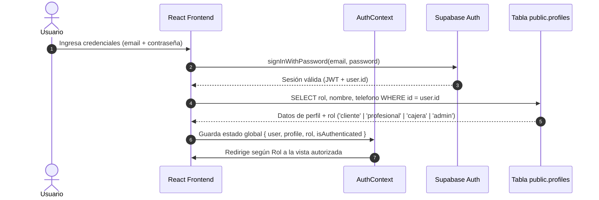
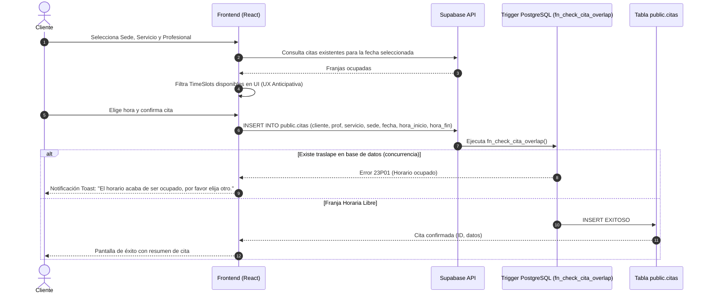

# SYSTEM_ARCHITECTURE.md
## Arquitectura de Software - Plataforma Web "Punto Corte"

Este documento describe la arquitectura global del sistema, el flujo de datos, el modelo de autenticación y autorización basado en roles (RBAC) y la estrategia de infraestructura a costo cero ($0 USD).

---

### 1. Diagrama de Arquitectura Global

---

### 2. Flujo de Autenticación y Autorización (RBAC)

---

### 3. Flujo de Agendamiento y Prevención de Traslapes

---

### 4. Estrategia de Infraestructura y Costo Cero ($0 USD)

1. **Vercel Hobby Tier:**
   - Despliegue estático continuo conectado a la rama `main` de GitHub.
   - SSL automático gratis con HTTPS forzado.
   - Redirección `/*` a `/index.html` mediante archivo `vercel.json` para enrutamiento SPA.
2. **Supabase Free Tier:**
   - 500 MB de base de datos PostgreSQL dedicada.
   - 50,000 usuarios activos mensuales en Auth.
   - Backups automáticos y alta disponibilidad sin costo.
   - Seguridad integral gobernada por Row Level Security (RLS).
